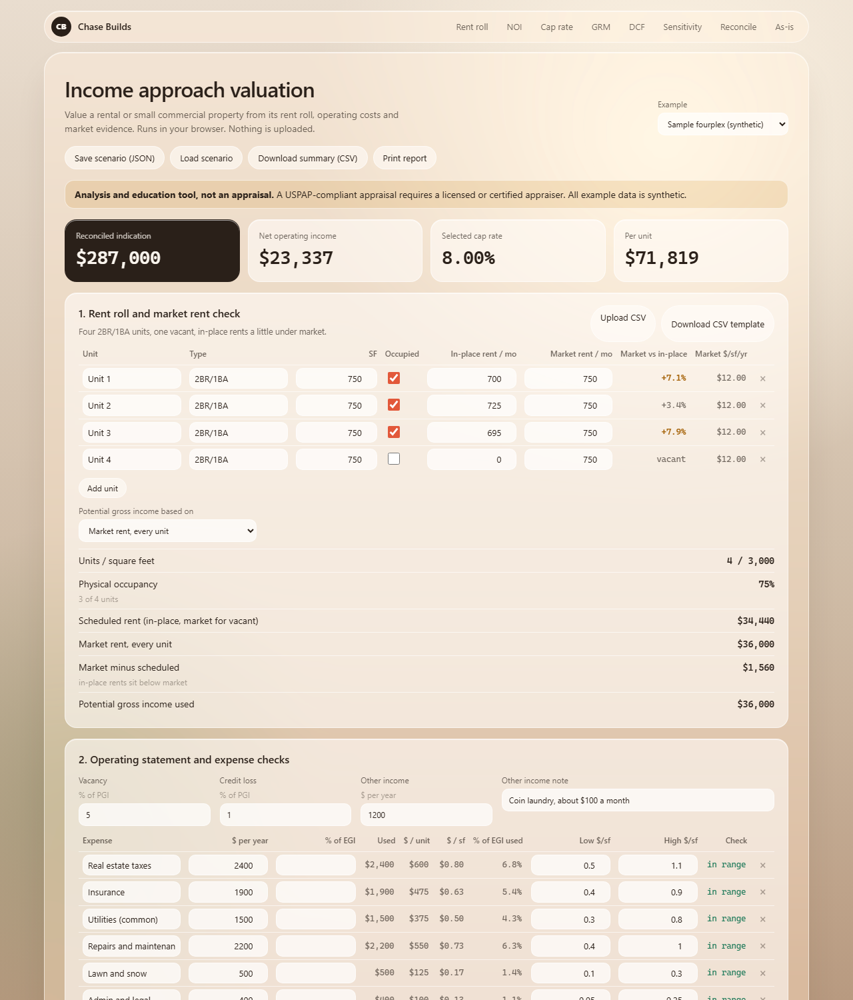

# Income Approach Valuation

[](https://github.com/chasebuilds/income-approach-valuation/actions/workflows/ci.yml)
[](LICENSE)

**Rent roll in, reconciled value out.** A browser tool that values rental and small commercial property by the income approach: rent roll, NOI, three value indications (direct cap, gross rent multiplier, DCF), a sensitivity table and a stabilized-to-as-is bridge. Save the scenario, export a CSV, or print a report. Nothing is uploaded.

**Live demo: https://chasebuilds.github.io/income-approach-valuation/**

> **This is an analysis and education tool, not an appraisal.** A USPAP-compliant appraisal requires a licensed or certified appraiser. Do not use the output for lending, tax, legal or sale decisions.



**Good fit for:** real estate offices, appraisers and assessors who want a worksheet that shows every step, and anyone who needs a similar tool built around their own market data.

## What it does

| Step | What you get |
|---|---|
| Rent roll | CSV upload or form entry. Each unit's in-place rent is compared with market rent, with $/sf/yr and a flag when in-place rent is more than 5% under market. |
| Operating statement | Potential gross income, vacancy, credit loss, other income, effective gross income, expenses and NOI. Expenses can be a dollar amount or a percent of EGI. Each line shows $/unit, $/sf and % of EGI, and is checked against a benchmark range you set. |
| Cap rate | Cap rate extraction table from comparable sales (price, NOI, gross rent) with median, mean and range. Band of investment calculator (loan to value, rate, amortization, equity dividend) with mortgage constant. Debt service coverage at the indicated value. Debt coverage ratio method (DCR x loan to value x mortgage constant) as a third cap rate check. |
| GRM | Gross rent multiplier from the same comps, applied to the subject's gross rent. |
| DCF | 5 to 10 year projection with rent growth, expense growth, capital reserve, terminal cap rate, selling costs and discount rate. Gives present value, unlevered IRR and NPV against a price. |
| Sensitivity | 5 by 5 table of value against cap rate and vacancy. |
| Reconciliation | Weighted indication from direct cap, GRM and DCF, range, spread, and warnings (for example a terminal cap below the going-in cap). |
| As-is bridge | Stabilized value less rent lost while vacant units lease up and other deductions (deferred maintenance, leasing commissions, tenant improvements). Appraisers hit this whenever a property is not fully leased. |
| Save and export | Save a scenario to JSON and load it back, download a CSV summary of every result, or print a clean report. |

Two synthetic examples are built in: a four-unit residential building and a four-bay strip retail center. Every number in them is made up. The expense benchmark ranges in them are illustrative, not market data.

## Example results (built-in synthetic fourplex)

| Item | Result |
|---|---|
| Potential gross income (market rent) | $36,000 |
| Net operating income | $23,337 |
| Direct cap at 8.00% | $291,710 |
| GRM 8.00 | $288,000 |
| DCF (5 years, 9.50% discount, 8.50% terminal cap) | $279,405 |
| Weighted 50/20/30 | $287,277, shown rounded as $287,000 |
| As-is (3 months to lease the vacant unit, $3,500 deferred maintenance) | $281,250 |
| Cap rate by debt coverage method (1.25x, 70% loan, 6.75%, 25 years) | 7.25% |

The strip retail example gives NOI $74,841 and a rounded indication of $842,000. These come from running the app on the synthetic data, not from any real property.

## Formulas

- Mortgage constant = 12 x (r / (1 - (1 + r)^-n)), with r the monthly rate and n the number of payments.
- Band of investment cap rate = M x Rm + (1 - M) x Re.
- Direct capitalization value = NOI / cap rate.
- GRM = price / annual gross rent. Value = GRM x gross rent.
- DCF value = sum of year-end cash flows discounted at the discount rate, plus the net sale price discounted from year N. Sale price = year N+1 NOI / terminal cap rate, less selling costs. Cash flow = NOI minus capital reserve.
- IRR is found by bisection on the cash flows with the price as the year 0 outflow.

## CSV format

```
unit,type,sf,rent,market_rent,occupied
Unit 1,2BR/1BA,750,700,750,yes
Unit 4,2BR/1BA,750,0,750,no
```

`unit`, `sf`, `rent` and `market_rent` are required. `type` and `occupied` are optional. The page has a template download button. Files are read in your browser and are never uploaded.

## Run it

```
npm ci
npm run dev        # local server
npm test           # 50 unit tests
npm run benchmark  # rewrites BENCHMARK.md
npm run lint       # ESLint
npm run typecheck  # TypeScript, strict
npm run build      # static site in dist/
```

## Tests

Vitest tests in `tests/` use numbers worked out by hand, with the arithmetic in the test comments:

- Mortgage constant for 6% over 30 years is 0.0719461.
- Band of investment at 75% loan and 8% equity dividend is 7.39596%.
- IRR checks: 10% for `[-100, 110]`, `[-100, 0, 121]` and a par bond; negative return; no sign change.
- DCF: a 3-year par bond PV of exactly $1,000; flat NOI with terminal cap equal to the discount rate returns value $550,000 and IRR 10%; a 3% rent growth case worked out to $789,359.50; capital reserve and selling cost cases; percent-of-EGI expenses.
- Rent roll parsing, expense per-unit and per-sf checks, comp statistics, sensitivity grid and reconciliation weights.
- Debt coverage cap rate: 1.25 x 0.75 x 0.0719461 = 0.0674495.
- As-is bridge: lease-up loss (750 + 800) x 3 months = 4,650; 287,000 - 2,250 - 3,500 = 281,250.
- Scenario JSON round trip for both built-in examples, rejection of bad files, and CSV quoting.

## Benchmark

`npm run benchmark` times the calculation library and checks IRR against closed-form answers, then writes [BENCHMARK.md](BENCHMARK.md). In the latest run a 10-year DCF with IRR took 13.27 microseconds per call, a 5 by 5 sensitivity grid 4.28, and parsing a 5,000-row rent roll CSV 3,530. The largest IRR error across six known cases was 6.08e-12. Timings vary by machine; see the file for the full table.

CI runs lint, type check, tests and build on every push. A second workflow publishes the site to GitHub Pages.

## Limitations

- Not an appraisal. A USPAP-compliant appraisal requires a licensed or certified appraiser.
- Output is only as good as the inputs. Cap rates, rents, expenses and growth rates must come from verified market evidence.
- Built-in data is synthetic, and the expense benchmark ranges are illustrative only.
- Simplified model: annual periods, year-end cash flows, one rent growth rate for all income, no leasing commissions, tenant improvements, loan fees or income tax.
- The DCF is unlevered. The band of investment is a cap rate tool, not a loan model.
- Reconciliation weights are your judgment. The tool only does the arithmetic.

## Tech

TypeScript (strict), Vite, Vitest, ESLint. No runtime dependencies. The built bundle is 27.25 kB of JavaScript (9.99 kB gzipped).

## License

MIT. Copyright Chase Builds.
